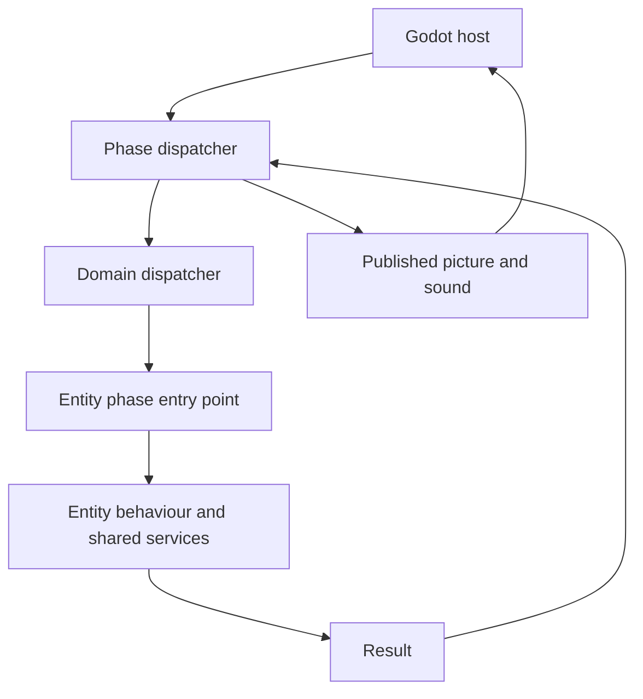

# Godot architecture

This is the design guide for the v1.0.0 Godot game. [The v1.0.0 manifesto](v1.0.0-manifesto.md) states the goal and
the rules; this document says how the project is built. Where they disagree, the manifesto wins.

The game is written new in Godot. The old C# code is reference material for what the game does. Nothing in its
structure is a constraint unless the player could see the difference.

This guide is not complete and is not meant to be. Each section ends with a note, **Why, and extending it**, that
says what the section is protecting and how to decide a case it does not cover. [The type system](godot-types.md)'s
section 0 gives the reasoning behind the whole design. When the work meets something not covered, extend the
section by its note, build it, and write the addition here in the same change.

## Using the old code

Use it to answer questions like:

- How fast does this move, how long does this last, how much damage does this do?
- What does this enemy do, in what situations, with what timing?
- What is in this room, and what happens when you enter or leave it?
- What odd thing does the game do here that a player would notice?

Do not use it to answer:

- What classes, files or folders should exist?
- How many objects is this thing made of?
- What state should an object hold, and in what fields?
- What should things be called?

The disassembly and bank references in AGENTS.md remain available for the same purpose.

## Things that are not carried over

These are the 1994 program's design, or the old code's echo of it. The list is for recognising them, not complete:

- Fixed slot arrays and behaviour that depends on slot position.
- One thing built from several entities because the original needed several slots for it.
- One flat enum of every pose, and lists of pose names standing in for a property.
- A speed size plus a direction flag; a separate direction enum for each kind of movement.
- A mode spread across several booleans and a "none" value.
- One large state object that every routine reads and writes.
- Gameplay changes made inside drawing code.
- Animation "instruction lists" stepped by an interpreter.
- Multi-tile objects made of one real tile plus tiles that point at it.
- Values left over in a reused storage place and read by the next thing to use it.

When one of these produces something the player can observe, keep the observable result, expressed in the new
design, in the one place it belongs (manifesto, section 5). Do not keep the mechanism.

**Why, and extending it.** Every item on this list is a way the 1994 program coped with its machine: fixed memory,
no objects, one routine per frame phase. None is a decision about the game. The list will grow as the old code is
read. The way to recognise a new one: the structure exists to manage storage or to fit the original's routines, and
a person describing the game to someone would never mention it. Add it here when found.

## Project layout

- The project is `godot/`. It has no references to the old code.
- It has three layers: `engine/` (a game engine with nothing of Super Metroid in it), `game/` (Super Metroid in
  code, built on the engine, including its compatibility layer) and `assets/` (Super Metroid's art, audio and room
  layouts as plain, neutral, editable files). `engine/` never references `game/`.
- [The type system](godot-types.md) gives the folder tree, every kind of type the game is made of, what each owns
  and manages, the rules for access and inheritance, and the questions that decide where a thing belongs. Work
  extends that system.
- One folder per thing, one class per file. No folder that collects unrelated things, and no file that collects
  many entities.

## Entities

- **One entity per thing the player sees as one thing.** A boss is one scene with one root script. Its head, arms,
  weak points and projectile spawn points are child nodes of that scene, not separate entities. How many slots or
  objects the original or the old code used for it is not evidence.
- Something is its own entity only when it lives on its own: it can exist, move or die independently of what made
  it (a projectile, a dropped pickup, a spawned minion).
- An entity's node owns its state and its behaviour. No separate state object handed to static routines, and no
  thin entity that forwards to a shared class.
- A thing with modes is a state machine. Data that only means something in one state lives in that state and stops
  existing when the state ends.
- Motion is a signed velocity. A value made of independent parts (facing, aim, what the player is doing) is held as
  those parts.
- Tunable data (speeds, health, damage, timings) is an ordinary property of its node or resource, visible in the
  editor. For this game its value comes from an external data file and shows read-only; with no file named it is
  edited and saved in the editor (type system, "Values from files").
- Live things are the objects that exist now. No fixed tables, slot numbers as identities or "empty" entries.

Every actor scene follows the same skeleton: root node with the actor's script; an `ActorVisual`; collider children
(see Collision); a state machine; any movement components it uses; and the data file its values come from.

**Why, and extending it.** An entity is the unit the player would point at and name, because that is the unit a
person editing a room, a modder changing a file and the owner building a new game all think in. Splitting one
thing across several entities is the old code's shape and is always wrong here. When a thing seems to need more
than one entity, ask what the player sees: one boss with arms is one entity with parts; a boss and the rocks it
throws are a boss and projectiles. When an actor needs something the skeleton lacks, it is a new child with one
job, and if a second actor needs the same child it becomes an engine component.

## The game loop

One coordinator owns advancing the game. It runs on Godot's normal `SceneTree`, from `_PhysicsProcess`, sixty
updates per second.

| Owner | Responsibility |
| --- | --- |
| Godot host | Engine integration, input collection, device output, presentation. |
| Phase dispatcher | The order of phases within one update, and branching, repetition, suspension and completion. |
| Domain dispatcher | Which of a domain's entities run, in what order, and when a new one is admitted. |
| Entity | Its own state and behaviour, exposed as one entry point per phase it takes part in. |
| Shared service | An operation or state several unrelated entities really share. |
| Composition root | Builds a game session from the `GameDefinition` and hands each object what it depends on. |

- Entities are stepped by the dispatchers' calls. They do not advance themselves from their own `_Process` or
  `_PhysicsProcess`, and Godot's node order, `_Ready` order and signal order never decide gameplay order.
- When another actor's work falls between two parts of an entity's update, the entity has two phase entry points.
  The dispatcher keeps the interleaving; the entity keeps its own logic.
- Phase entry points are typed interfaces. An entity implements only the phases it takes part in; no empty methods.
- Being registered (it exists), taking part (it implements a phase) and being eligible (it runs this time) are
  three separate things. Eligibility is decided at the point of the call, not from a mask taken at the start of
  the update.
- Behaviour that belongs to one enemy lives in that enemy. The dispatcher knows when the enemy runs, never what it
  does.
- Calls are ordinary synchronous calls with immediate effect. Something is deferred only when it really takes
  effect later, and then the place it is consumed is named. No event bus.
- Only complete updates run. Gameplay never takes elapsed time, never interpolates its own positions and never
  skips a phase. When the host falls behind it runs whole updates to catch up, up to a cap.
- Do not replace Godot's `MainLoop`, and do not move gameplay to a worker thread, unless a specific need is shown.

Order matters only where it changes a result. Two places the old code's order is known to matter, to be confirmed
when they are built and kept only if the player could tell: each enemy finishes being hit before it acts, enemy by
enemy, and part of the player's update runs before the enemies and part after. Find the rest per slice; where order
changes nothing, it is free.

### Pausing and waiting

A message box, the pause screen, the X-ray scope, a suit pickup and a host suspend each stop different things and
resume differently. Each is its own explicit state with its own resume point. Do not use `await`, a generic wait,
or one global pause flag (including `SceneTree.paused`) for them.

A state that stops all of play (a message, the pause screen, a room transition) is a `GameMode` laid over the
playing mode: it names the mode it keeps, that mode stays on screen and is not stepped, and control returns to it.
Where play is to go on beneath such a mode for a while (this game's pause screen darkens the screen over play
that is still running, and brightens it again the same way), the mode laid over steps the playing mode itself for
those updates (`PlayingMode.PlayBeneath`), on terms that say what it holds off meanwhile (`PlayTerms`: the
player's death, a save from it, the pause, a session service's taking over, the count of the play time), and hands over at once to whatever
play names instead; on its own last update it may take that as its game has it (this game's pause, on the last
update of each of its fades, as the cartridge's does).
A state that stops only some things while play goes on is the playing mode's answer to "what is stopped this
update", which the room is given with the update's input.

### Spawning and removing

For each kind of thing, state when it is created, when it first takes part in an update, when removal takes
effect, and when its Godot node is freed. `QueueFree` is deferred; gameplay removal must not depend on when Godot
gets round to it. A pool that has a limit keeps its limit and its behaviour when full.

### Failures

One guarded boundary at the host. A participant does not catch an error and let the rest of the update continue on
half-finished state, and nothing retries a phase automatically. AGENTS.md's no-dialog error policy applies.

**Why, and extending it.** The loop exists so that the order things happen in is written down in one place and is
the same every time. Godot will happily run every node's own callback in tree order; the moment gameplay depends on
that, the order is hidden in the scene tree and changes when someone rearranges a scene. So the rule for anything
new: if it changes gameplay state, it is called by the loop at a named point, and if two things' order could matter,
their order is stated. Start a new phase or entry point only when something really must happen between two existing
ones; otherwise it joins the phase it belongs to. Do not copy the old code's phases: begin from the simplest order
(player, then enemies, then projectiles, then the room) and split only where a result the player can observe
requires it.

## Shared state and services

- State that several systems must agree on is one instance handed to each of them (one weapon cooldown shared by
  beams, missiles and bombs). Handing it to more consumers must not make it advance more than once.
- Lifetimes are chosen from what the state is for:

| Situation | Lifetime |
| --- | --- |
| Survives room changes and entity deaths | The game session. |
| Rebuilt for each room or encounter | The room or encounter, with defined setup and teardown. |
| Belongs to one actor | That actor. |
| Shared and never changes | A shared definition resource. |

- No process-wide mutable state: no mutable statics, and no autoload used as a global bag. Two sessions (the game
  and an editor preview) must be able to exist at once.
- Dependencies are handed over when an object is built. No service locator, and no "world" object that exposes
  everything.
- Shared code does not mean shared state. A movement routine can serve every actor while each keeps its own
  position.
- **Random numbers.** Gameplay uses one shared generator and the order of draws matters. Cosmetic effects and
  previews never draw from it.

**Why, and extending it.** Shared state is where the old code's worst habits hide: a value several routines happen
to read, living nowhere in particular. Here a shared thing has exactly one owner and a lifetime, and is handed to
whoever needs it. When something new must be shared, decide three things in order: who owns it, how long it lives
(session, room, one actor), and who is handed it. If it must be shared by unrelated systems for the whole session,
it is one of the listed shared services or part of one; a new shared service is a rule change, not an extension.
Most things that look shared turn out to belong to one owner that others ask.

## Collision

The game has its own small collision system. Godot's physics is floating-point and decides its own ordering, so it
is not used for gameplay: no `CharacterBody2D` movement, no `Area2D` signals, no physics layers deciding outcomes.

Everything the game collides is an integer, axis-aligned rectangle or a tile. There are no circles, polygons or
rotation. That is small enough to own.

**Colliders**

- A collider is a child node of the entity it belongs to: a rectangle relative to the entity's origin, placed and
  sized in the editor and drawn there.
- A collider has a role: *body* (moves against terrain), *hurtbox* (can be hit), *hitbox* (hits), *solid* (blocks
  the player).
- A boss's separate parts are separate hurtbox nodes of the one boss scene. A hurtbox says which part it is; the
  boss decides what a hit on that part does.
- Where hitboxes change with the animation, the animation turns collider nodes on and off or moves them. No code
  tables of rectangles per frame.

**Terrain**

- A room's terrain is its tile grid. Each tile kind has collision data: empty, solid, a slope with a height per
  pixel column, or a block that reacts (spike, breakable, crumbling).
- A door cap, a gate or a breakable wall is a `Barrier`: an object with its own collider and health, not a group of
  tiles. The way out behind it is a separate `RoomExit` region (type system, "Barriers and exits").

**Moving**

- Positions are fixed-point: whole pixels plus a fraction, in one position type. No floats in gameplay movement.
  A thing is shown at the whole pixel its place lies in (`PixelPosition.ToDisplay`), as the cartridge shows it: the
  fraction is for moving, never for where a picture is drawn.
- One mover moves a body along one axis by a displacement and reports how far it got and what stopped it. The
  player, enemies and projectiles all use it.
- Any actor may have a solid collider. A solid blocks the player and can be stood on, and when a solid moves, the
  mover carries what stands on it. Platforms, frozen enemies and anything else stood on work this one way.
- Differences between movers are options on the call (how slopes are treated, how much of the way is tried), not
  separate movement routines per kind of actor. The plain move tries every pixel of its way; a move may instead be
  tried only where it would end, which is how the cartridge moves Samus (type system, section 7).

**Overlaps**

- A room has one collision world. Colliders register with it; it answers "what does this rectangle overlap" with
  results in a defined, stable order.
- Whether edges that only touch count is an option on the query.
- The collision world finds overlaps. It does not decide what they mean.

**Prototype**

Build this much, in the engine with stand-in content, before anything depends on it: a player moving on terrain with
slopes; one simple enemy; one enemy with several hurtboxes, as a boss has; shots against all three. If one system
handles those cleanly, continue. If it does not, stop and bring what failed to the owner.

A few collision results in the original come from how it stored things, not from geometry. When a slice meets one,
apply the manifesto's test. If the player can observe it, it is kept: in the one enemy or object it belongs to, or,
if it changes how the engine's collision behaves, as a compatibility answer to a named option on the collision call.
The engine's default is always the plain geometric result.

**Why, and extending it.** The engine owns collision because the game needs exact, repeatable results and Godot's
physics gives neither. It stays small because everything collided is a rectangle or a tile. Two things must stay
true as it grows: there is one mover and one overlap query, and collision only finds things, never decides what a
contact means. A new need is a new option on an existing call with the plain behaviour as its default. A new shape
(a circle, a rotated box) would be a real change to the system and is not an extension. If a case seems to need a
second mover or a special collision routine for one kind of actor, the difference is an option that has not been
named yet.

## Interactions

- An entity affects another through that entity's own methods. Nothing writes another entity's fields.
- A hit is delivered to the target: the attacker's hitbox meets a hurtbox, the target's "take hit" is called with a
  small value describing the hit, and the target decides what happens.
- Nothing tests what kind of enemy or object something is. It asks through an interface for the thing it needs (can
  this be grappled, can this be stood on).
- Signals are for announcing something to whoever is listening (died, room changed), mainly to presentation. They
  do not carry gameplay decisions whose order matters.

**Why, and extending it.** Each thing decides its own fate. That is what lets an enemy, a barrier or the player be
understood, tested and replaced on its own, and it is what lets the fork swap every particular thing out. For a new
interaction, name the two sides and ask which one's state changes: that one gets a method, the other calls it and
passes a small value describing what happened. If both change, there are two methods. If one side needs to know
something about the other first, it asks through an interface named for the question. If you find one thing
switching on what another thing is, an interface is missing.

## Rooms and scenes

- A room is a scene: its `Terrain`, placed entity instances, exits and its own settings. The tile layout is an
  asset the `Terrain` loads, shown in the editor but never stored in the scene (type system, "Assets").
- Scene node order is for the editor's convenience and never decides gameplay order. Where order matters it is
  stated explicitly in the room's data.
- A scene is authored content. Runtime changes (a destroyed block, an opened door) live in runtime state and never
  edit the shared scene resource.
- A room change is one explicit operation with defined teardown, setup and activation points, carrying across what
  must carry across. Swapping scenes is not that operation by itself, and loading must not let extra updates run
  while it waits.
- The engine never assumes this game's content: no fixed number of rooms, areas, enemies or items, and no list of
  them, in engine code. A room, enemy or item someone adds or changes works without touching the engine.
- A room that differs by what has happened is still one scene: placed things have a "present when" condition and
  the room's settings have versions (type system, section 5).

**Why, and extending it.** A room scene is where the owner and anyone else will spend their time in the editor, so
it should read as the room: open it and see what is there. Hence one scene per room, real nodes for placed things,
and runtime state kept out of the scene. Anything new that belongs to a room is a node placed in it or a setting on
it; anything that changes while playing lives in the room's runtime state and is lost when the room is left unless
it is remembered.

## Input

- Held buttons and presses are kept until the update that samples them, so a tap between two updates is not lost.
- Input is sampled once per update. A rendered frame may contain several updates or none; rendering never consumes
  or duplicates a press.

## Audio

- What the game asks to be played, and when, is decided inside the update. Device latency, mute and device failure
  never change gameplay.
- A buffer the game reuses is copied or handed over before it is queued for playback.
- Gameplay asks `SoundRequests` by name; the session's `ISoundFlow` decides whether each request is let in and on
  which update it starts; the `AudioDirector`, a child of the game loop that runs after it, takes what started
  each update and plays `<sound folder>/<name>.wav`, and follows the music playing. A name with no file is an
  error, not silence.
- What waits to be heard is game state where the game reads it. This game's flow is the cartridge's
  (`CartridgeSounds`, in the compatibility layer): an update opens with the music's turn, the mode plays it, and it
  closes with the sounds' turns and the sound program's clock. The flow is the game's (`GameDefinition.CreateSoundFlow`); the engine has none of its own.
  The sound program the flow's libraries wait on is given to the flow (`ISoundProgram`): when it answers is the
  timing of the hardware it ran on. The game's own answers by the program's clock (`SoundProgramClock`); the host
  of a recorded movie gives one that answers when the recording's did (`MovieGame`, with the movie check). The
  time a set of music takes to load is given to the flow the same way (`IMusicLoadTime`) and passes on the
  session's clock with no update played (`GameClock.Pass`): none in the game, the console's in a recorded movie.

## Presentation

- **Position.** Gameplay positions are exact and authoritative. They are projected into Godot coordinates for
  display and nothing reads the displayed position back.
- **What is shown.** The picture shows the state as it stood at the end of an update. Repainting, resizing or
  attaching a view never advances the game.
- **Effects.** Layer priority, colour blending, windows, per-line distortion and the rotating floor are done with
  Godot shaders and layers that implement what the effect needs. Plain sprite stacking is used only where it gives
  the right picture.
- **Pixels.** Textures are sampled unfiltered, with atlas padding where needed. Nothing is scaled down.

### Animation

- An animation whose timing matters to play is a `FrameTimeline`, stepped by its owner through a `TimelinePlayer`
  once per update. Each step names the picture to show by its path in the assets tree; `ActorVisual` shows it.
- Godot's `AnimationPlayer` and `SpriteFrames` are used only for motion that is purely for show, and never hold a
  direct reference to an asset file (type system, "Assets").
- Every frame of an actor shares one origin. Frames are not centred independently.
- Gameplay timing never lives in Godot's animation. Damage, spawning, sounds and death completion are not driven by
  animation-finished signals or method tracks. Gameplay picks the frame to show.
- Where colours change independently of shape (suit changes, flashes, glows), use a shader over the artwork, not a
  baked copy per colour, unless the copies cover every case.
- A meaningful blank frame keeps its identity and duration. Missing artwork is an error, never a silent blank.
- No node per tile, and no baking of every possible combination of parts.
- Assets never ship with the exported project. They are loaded from the installed assets folder, through
  `ContentLibrary` only: a folder named `assets` beside the exported game's executable, or on Android in the
  game's own folder of the device's storage (`ContentLibrary.InstalledFolder`). An exported game that finds none
  has them made first, if its definition says how (`GameDefinition.AssetsMaker`): `AssetsSetup` asks the player for
  the file they are made from, keeps it, has the maker make them, showing how far it has come, and then lets the
  game begin. It does the same, without asking, when the assets there were made by another version of the maker,
  so a new version of the game never plays on an old one's assets. One whose definition gives no maker says where
  its assets belong and starts nothing. This game's Android build makes them on the device from the ROM the player
  chooses (`Game.RomAssets`); its Windows build has a program beside it that makes them.

**Why, and extending it.** Presentation follows the game and never leads it: the game must play identically with
the screen off. So everything shown is derived from gameplay state at the end of an update, and nothing shown is
read back. For any new visual, ask whether removing it would change what happens. If it would, part of it is
gameplay and that part belongs in the update, with only the look left here. Use Godot's own rendering features
freely for the look; they are only off limits as a clock or as a source of gameplay facts.

## Project settings

- The game draws at 256 by 224 and is scaled up to the window by whole multiples only. Nothing is scaled down.
- Textures are unfiltered.
- Godot's physics rate is sixty per second; that tick is the game's update.
- Godot's generated `.godot/` folder and `assets/` are git-ignored. Everything else in `godot/` is committed.
- The project was created on Godot 4.7.2 (.NET build) and targets .NET 10, the newest of each when it was made. It
  uses Godot's Compatibility renderer, which is all a pixel game of flat images needs.
- The project, its one C# assembly and its root namespace are all named `Engine`. Inside that namespace Godot's own
  `Engine` and `Input` classes are written `Godot.Engine` and `Godot.Input`.
- The game to run is named by the project setting `engine/game_definition`. With none set, the program prints the
  error and exits with a failing code.

## Building and checking

- The Godot project is built and run from the command line without opening the editor. `godot/build.ps1` builds it
  and `godot/check.ps1` builds it and then runs its checks; they are the only way the agent builds or checks.
- The build also fails on what compiles and still cannot load in the editor (`godot/check-editor-types.ps1`, run by
  `build.ps1`): a class made in the editor (`[Tool]`) whose exported property is of a script type that is not made
  there. The editor hands such a property a placeholder it cannot take and reports an invalid cast. The owner's rule:
  "These errors shouldn't be possible in the editor, and should be caught by whatever \"build\" script you're using."
  A script type held by a `[Tool]` class is marked `[Tool]` as well.
- The scripts find Godot through the `GODOT4_BIN` environment variable, set at user scope to the Godot .NET
  executable (the main one, not the `_console` launcher, which fails when its path contains a space).
- Checks run with `--headless`: no window opens and nothing is drawn, so running them does not use the graphics
  card.
- A check is a public, parameterless method marked `[Check]`, on a class under `engine/tests/` or `game/tests/` in
  the folder mirroring what it checks. The one test-runner scene finds every such method, runs each on a fresh
  instance, prints every failure in full and exits with a failing code if any failed. `check.ps1` followed by names
  runs only the checks whose class or method name contains one of them. No third-party test framework.
- Engine checks use only the engine's own stand-in content, so they pass with `game/` and `assets/` deleted.
  The stand-ins are in `engine/tests/`: `StandInRoom` (terrain, collision and a mover), `StandInWorld` (a session,
  a player and one room, stepped directly), `StandInGame` (two rooms played through the loop and the engine's
  modes), and `TempAssets` (a throwaway assets folder the check writes its own files into).
- The checks' objects are not in the scene tree. The few things that work only inside it, such as playing sound,
  are put under `TestRunner.Stage` for the length of the check.
- What needs a window is not checked this way and has not been run: drawing, the device input source, and the
  editor opening the project. Opening a window or the editor uses the graphics card; ask first.
- A check builds the smallest scene that shows the behaviour and asserts what the player would observe. It does not
  assert internal fields, and nothing is made public for it.
- A failure anywhere prints the full error and ends the process with a failing exit code. No dialogs, in the game
  or in the checks.

**Why, and extending it.** Checks exist to confirm the thing just built does what it should, as a player would see
it, and to keep the engine provably free of the game. They are not a way to hunt for problems and not a measure of
internal shape. A new check asks one question about observable behaviour with the least content that can show it.
An engine check that needs something from `game/` to pass means either the check or the engine has a piece of
Super Metroid in it.

## Build order

The work is done in this order. Each stage's types are in [the type system](godot-types.md).

1. Remove the old-code instructions from AGENTS.md (#2579).
2. **Foundation:** the project and its settings, the build and check scripts, the shared values, `ContentLibrary`,
   `InputSampler`, `GameDefinition`, `GameSession` and `GameLoop`.
3. **Two proofs.** Nothing below starts until both work.
   - The collision prototype (see Collision).
   - Values from files: one stand-in enemy whose health and speed come from a text file, shown read-only in the
     inspector when it is clicked in a room, not written into the scene when the scene is saved, loaded the same
     way by an exported build, and editable and saved when no file is named. If Godot cannot do all of that with
     one mechanism, stop and bring what failed to the owner.
4. **The player:** the engine's `Player` controller, its standard states, `Inventory` and `Weapons`, then Samus on
   top of it, in a test room.
5. **Rooms:** `Terrain` and blocks, `Room` setup and teardown, exits, barriers and the room transition, the camera
   and its zones, liquids, room effects, backdrops; then this game's rooms.
6. **Room objects:** every engine kind, then this game's use of each.
7. **Enemies:** the engine's `Enemy`, `Projectile`, `Pickup` and `Effect`, then every enemy of this game.
8. **Bosses:** every boss, its encounter and its room's sequence.
9. **Screens:** the engine's message box, map view, saving and options, then this game's HUD, pause screen and menus.
10. **Cinematics and the rest:** title and demos, intro, Ceres, the escape, ending and credits.
11. **Export** for Windows.

In every stage the engine part is built first, checked with stand-in content, and only then used by the game part.
If building a thing of this game shows the engine is missing something any game would want, the engine gets it
first.

Each asset format is defined, and documented beside `ContentLibrary`, in the stage that first needs it, and the
asset extractor is changed to write it in that same stage. That is the one place v1.0.0 work touches the old
repository's code: the extractor's output, and whatever small change lets the extractor read a value it needs.
The extractor reads the old code's definitions only for now. Once the Godot game is at parity the old code is
deleted and the extractor holds its own definitions; that decoupling is v1.1.0 work, not part of v1.0.0. It cannot
be done sooner: the extractor is only known to be isolated when the old code is gone, and the old code has to stay
while the Godot game is still being written from it. So a value
typed where it could have been read from the old code is not a defect, so long as it is right.

Sound is added with each stage's things; `SoundRequests` and `AudioDirector` are built in stage 4.

The project is ready for replay testing when every item in the type system's section 10 exists and the game can be
played from the title to the credits. The owner decides when that is so.

**Why, and extending it.** The order is: prove the risky ideas, then build each engine system before the game
things that use it, working outward from the player. That way every piece of Super Metroid lands on an engine part
that already works with stand-in content, and the engine never gets shaped around one enemy's needs. Stages can be
split into as many tickets as the work needs. Within a stage, order by dependency and do the general thing before
the particular. If a later stage shows an earlier engine part was wrong, fix the engine part; do not work around
it in the game.

## Working a slice

1. **Learn it.** From the old code and the references, write down what the slice does as the player experiences
   it: behaviours, numbers, timings, quirks.
2. **Design it.** Describe the scenes, nodes, states, colliders and resources. Check it against the manifesto's
   test and this document. If it mirrors the old code's class list or object count, redesign.
3. **Build it** from that design, not from the old code's files.
4. **Confirm it** with a focused check of what the slice does. Not with a recorded movie: the replays are off
   limits until the owner opens testing (manifesto, section 4).
5. **Report** what the slice does, how it is built, each original structure that was not carried over, and each
   quirk kept and where it lives. Anything the slice still does differently from the old game is not part of a
   finished slice: each such difference gets its own ticket in the v1.0.0 milestone (AGENTS.md, "Full parity with
   the cartridge is required").

## Checking parity

Replay testing does not start until the owner says the project is architected and ready for it. Until then the
agent does not run the movies, read their traces, build replay tooling, or let them influence the design.

Once the owner opens it, the recorded movies are replayed through the Godot game from their inputs and compared on
observable results (manifesto, section 4). A mismatch is investigated from the observable that differs; the fix is
in the new design, not a step back toward the original's structure.

## Open decisions

The manifesto's section 7 lists what the owner has not decided. Do not settle any of it in a ticket or in code.
